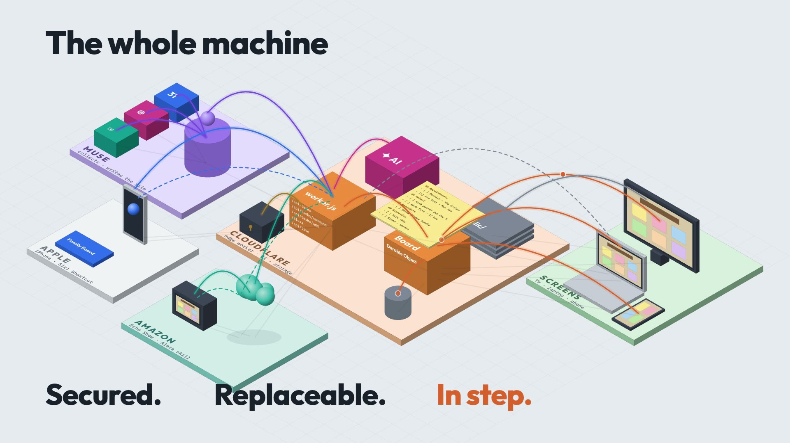
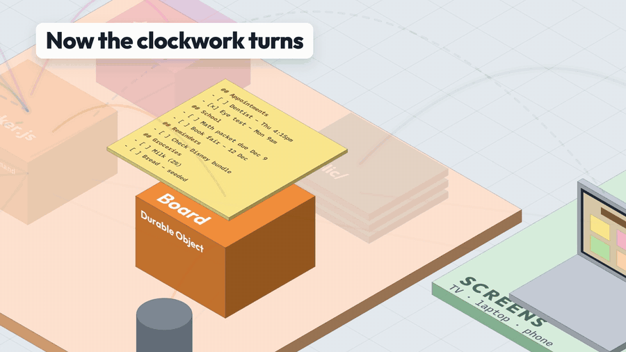
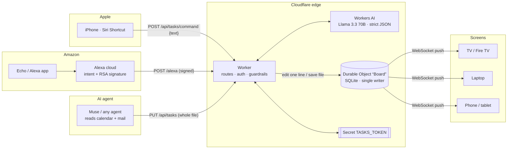
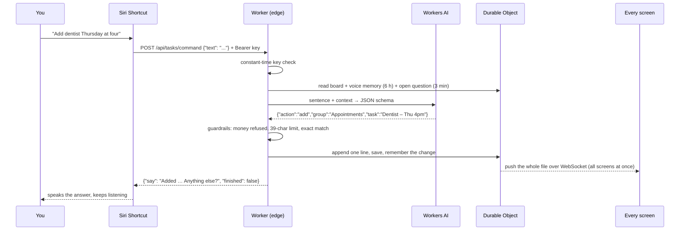
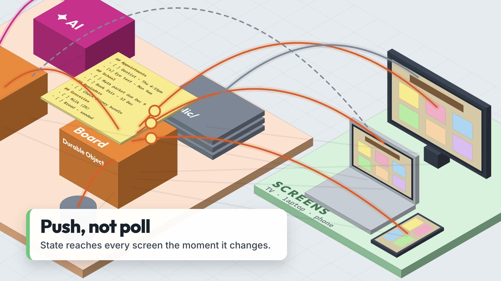

# Siri + Alexa + AI → Cloudflare Edge → Every Screen

### A real-time, cross-ecosystem system architecture you can deploy for free in 5 minutes

[](https://deploy.workers.cloudflare.com/?url=https://github.com/DeepSubz/siri-alexa-cloudflare-realtime-board)
[](LICENSE)


**One spoken sentence. Four ecosystems that were never designed to talk to each other. Near real time.**

Say *"Hey Siri, add dentist Thursday at four"* in the kitchen, and a moment later it is handwritten on a post-it note on the living-room TV. Say *"Alexa, cross off the math packet"* in another room, and it is crossed out on every screen in the house at the same moment. An AI assistant that reads your calendar and mail keeps the whole list up to date in the background.

The visible project is a family post-it board. **The real subject is the architecture underneath:** how Apple, Amazon, an AI agent and Cloudflare's edge network become one consistent, real-time system, with no servers to run and nothing to pay.





---

## Table of contents

- [What is this?](#what-is-this)
- [Architecture at a glance](#architecture-at-a-glance)
- [The architecture patterns it demonstrates](#the-architecture-patterns-it-demonstrates)
- [Quick start: free, 5 minutes](#quick-start-free-5-minutes)
- [Step-by-step setup (detailed)](#step-by-step-setup-detailed)
- [Connect Siri](#connect-siri)
- [Connect Alexa](#connect-alexa)
- [Connect an AI agent](#connect-an-ai-agent)
- [Put it on a TV](#put-it-on-a-tv)
- [API reference](#api-reference)
- [The task file format](#the-task-file-format)
- [Security model](#security-model)
- [What does it cost?](#what-does-it-cost)
- [Project structure](#project-structure)
- [Architecture decisions](#architecture-decisions)
- [The explainer film, rendered from code](#the-explainer-film-rendered-from-code)
- [FAQ](#faq)
- [Troubleshooting](#troubleshooting)
- [Contributing](#contributing) · [License](#license)

---

## What is this?

**Siri-Alexa-Cloudflare Realtime Board** is an open-source reference architecture that connects **Apple Siri Shortcuts**, an **Amazon Alexa skill** and **any AI agent** (for example Meta's AI assistant Muse, ChatGPT, Claude or a scheduled script) to a single **Cloudflare Worker**. The worker uses **Workers AI (Meta Llama 3.3 70B)** to understand plain-English sentences, stores the shared state in one **Durable Object** with built-in SQLite, and pushes every change to every open screen over **WebSockets**. The screens render a 3D post-it wall with **Three.js**.

It is built to be read, deployed and learned from:

- **Free to run** on Cloudflare's free plan.
- **Zero servers.** Everything runs at the edge.
- **One file of truth.** The whole state is a human-readable Markdown file.
- **Real integrations.** Real Siri, real Alexa with Amazon request-signature verification, real LLM function-style JSON output with deterministic guardrails.

## Architecture at a glance



**One event, end to end** (Siri):



A full interactive map lives in [`docs/architecture.html`](docs/architecture.html) (open it in a browser), and a written walkthrough in [`docs/ARCHITECTURE.md`](docs/ARCHITECTURE.md).

## The architecture patterns it demonstrates

| Pattern | Where you can see it |
|---|---|
| **Event driven** | Every change starts as one event from any ecosystem: a Siri sentence, an Alexa intent, or an agent's upload. |
| **Single writer, strong consistency** | One Durable Object (`idFromName("family")`) orders every write. Siri, Alexa and the agent can never overwrite each other. |
| **Compute at the edge** | A Cloudflare Worker handles routing, auth, AI calls and guardrails close to the user. No servers, no containers. |
| **AI with guardrails** | The LLM only *interprets* (strict JSON schema). Deterministic code *decides*: money is refused, tasks are trimmed, and a task must exactly match before it is crossed off. |
| **Push, not poll** | Hibernatable WebSockets push the new state the instant it is saved. Polling is only a fallback (60 s while live, 2 s if the socket drops, exponential reconnect 1 s → 60 s). |
| **Zero trust between vendors** | Apple and the agent use a shared secret checked in constant time. Amazon's requests are verified with its signing certificate chain, the RSA-SHA256 signature, a 150-second freshness window and the skill ID. |
| **Human-readable state** | The single source of truth is Markdown: people read it, AI writes it, and the screens parse it with no AI at all. JSON is used only on the wire. |
| **Conversation memory at the edge** | The object remembers the last voice changes (6 h) and its last question (3 min), so "undo", "the last one" and "the Thursday one" work. |
| **Graceful degradation** | No AI? Use `/add`, `/done`, `/remove` or `PUT`. No WebSocket? Polling. No GPU? The board only redraws when something moves. |



---

## Quick start: free, 5 minutes

You need a free [Cloudflare account](https://dash.cloudflare.com/sign-up) and, for option B, [Node.js 18+](https://nodejs.org).

### Option A: one click

1. Click **Deploy to Cloudflare** at the top of this page.
2. Sign in to (or create) your free Cloudflare account and confirm. Cloudflare copies this repo to your GitHub account and deploys it.
3. When asked for `TASKS_TOKEN`, paste a long random string (a password-manager generated one is perfect). If you were not asked, add it afterwards: **Cloudflare dashboard → Workers & Pages → family-board → Settings → Variables and Secrets → Add → Secret**, name `TASKS_TOKEN`.
4. Open the `*.workers.dev` address Cloudflare shows you. That's your board.

### Option B: one command

```bash
git clone https://github.com/DeepSubz/siri-alexa-cloudflare-realtime-board.git
```

```bash
cd siri-alexa-cloudflare-realtime-board && npm install
```

```bash
npm run setup
```

`npm run setup` signs you in to Cloudflare in your browser, deploys the worker, the Durable Object and the board to **your own account**, creates a random write key, stores it as an encrypted secret, and prints your board address and key. Save the key in your password manager: it's shown once.

Test it from a terminal (replace the two placeholders):

```bash
curl -X POST https://<your-worker>.<your-subdomain>.workers.dev/api/tasks/command -H "Authorization: Bearer <write key>" -H "Content-Type: application/json" -d '{"text":"Add milk to groceries"}'
```

Moments later the board in your browser shows **Milk** on the Groceries post-it, without a refresh.

---

## Step-by-step setup (detailed)

If you prefer to see every step:

1. **Create a free Cloudflare account** at <https://dash.cloudflare.com/sign-up>.
2. **Install Node.js 18 or newer** from <https://nodejs.org>.
3. **Get the code:** `git clone https://github.com/DeepSubz/siri-alexa-cloudflare-realtime-board.git`, then `cd siri-alexa-cloudflare-realtime-board` and `npm install`.
4. **Sign in:** `npx wrangler login` opens your browser to authorise Wrangler, Cloudflare's CLI.
5. **Deploy:** `npm run deploy`. The first time, Wrangler asks you to pick a free `workers.dev` subdomain. It creates:
   - the Worker `family-board` with your board at `https://family-board.<your-subdomain>.workers.dev`
   - the Durable Object class `Board` with SQLite storage (free plan)
   - the Workers AI binding
6. **Set the write key:** `npx wrangler secret put TASKS_TOKEN`, then paste a long random string. Anyone with this key can change the board; reading needs no key.
7. **Open the board** at your `workers.dev` address. Until the first write it shows the starter list from [`public/tasks.md`](public/tasks.md).
8. **Make it yours:** edit `public/tasks.md` (groups are `## Headings`, tasks are `- [ ] lines`) and run `npm run deploy` again, or send the whole file with `PUT /api/tasks`.
9. **Optional settings** in `public/index.html` (the `CONFIG` block at the top): `boardTitle`, `doneHours` (how long a fully crossed-out note stays up), `latitude` (for sunrise and sunset lighting), `bedtime`.

**Local development:** copy `.dev.vars.example` to `.dev.vars`, then `npm run dev` and open <http://localhost:8787>. Workers AI calls go to Cloudflare even in local mode, so stay signed in.

---

## Connect Siri

A single Siri Shortcut turns the board into a conversation: *"Hey Siri, Family Board" → "What should I update?" → "Cross off the dentist" → "Crossed off … Anything else?"*

Full click-by-click guide: **[docs/SIRI_SHORTCUT.md](docs/SIRI_SHORTCUT.md)**. In short, one shortcut that:
1. asks *"What should I update?"*,
2. sends `POST /api/tasks/command` with `{"text": <what you said>}` and your key,
3. speaks the `say` field of the answer,
4. repeats until `finished` is `true`.

## Connect Alexa

A private (development-mode) Alexa skill works on all your own Echo devices without Amazon review or publishing. The worker verifies every Amazon signature before it acts.

Full guide: **[alexa/SETUP.md](alexa/SETUP.md)**. In short:
1. Create a custom skill at <https://developer.amazon.com/alexa/console/ask>.
2. Paste [`alexa/interaction-model.json`](alexa/interaction-model.json) into the JSON editor and build. The invocation name is *"post it board"*.
3. Set the endpoint to `https://<your-worker>.<your-subdomain>.workers.dev/alexa`.
4. Put your Skill ID in `wrangler.jsonc` (`ALEXA_SKILL_ID`) and run `npm run deploy`.
5. *"Alexa, open Post It Board."*

## Connect an AI agent

Any agent that can make an HTTPS request can keep the board up to date. In the original build, Meta's AI assistant Muse reads the family calendar and inboxes, rewrites the file by the house rules and uploads it in one request. ChatGPT, Claude, Gemini, n8n, Zapier or a cron job work the same way.

Guide and ready-to-paste agent instructions: **[docs/AI_AGENT.md](docs/AI_AGENT.md)**.

```bash
curl -X PUT https://<your-worker>.<your-subdomain>.workers.dev/api/tasks -H "Authorization: Bearer <write key>" -H "Content-Type: text/markdown" --data-binary @public/tasks.md
```

## Put it on a TV

- **Fire TV / Fire Stick:** open the Silk browser and go to `https://<your-worker>.<your-subdomain>.workers.dev/?tv=1`. TV mode keeps the screen awake (Wake Lock plus a silent looping video), renders at a device pixel ratio of 1 and limits effects for low-power hardware. It is detected automatically on Fire TV.
- **Any smart TV, tablet or spare laptop:** open the same address in a browser and go full screen.
- **Low-power devices:** `/classic` is a lighter CSS-only board.

Living-wall details: notes are handwritten on bendable paper, today's tasks are highlighted and stamped, overdue to-dos turn red, past events fade, the light follows the real sunrise and sunset, and the board dims at bedtime. Autumn leaves, winter snow and holiday touches appear on their own. Preview any moment with `?date=2026-12-24&time=19:30&demo=1`.

---

## API reference

| Method & path | Auth | Body | What it does |
|---|---|---|---|
| `GET /api/tasks` | none | | Returns the task file as `text/markdown`. |
| `PUT /api/tasks` | Bearer key | `text/markdown`, ≤ 256 KB | Replaces the whole file and pushes it to every screen. |
| `POST /api/tasks/command` | Bearer key | `{"text": "cross off the dentist"}` | One spoken sentence → add / done / reopen / remove / finish. Returns `message`, `say`, `finished`, `needsAnswer`. Keeps conversation memory. |
| `POST /api/tasks/add` | Bearer key | `{"group": "School", "task": "…"}` | AI shortens the task to ≤ 39 characters and appends it under an existing heading. |
| `POST /api/tasks/done` | Bearer key | `{"group": "…", "task": "dentist thu"}` | Crosses out exactly one matching open task (`404` none, `409` several). |
| `POST /api/tasks/remove` | Bearer key | `{"group": "…", "task": "…"}` | Deletes exactly one matching line. |
| `GET /api/tasks/list[?group=]` | none | | JSON list of groups, or one group's tasks (handy for Shortcuts menus). |
| `POST /alexa` | Amazon signature + skill ID | Alexa request JSON | Alexa intents → the same brain as `/command`. |
| `GET /api/live` | none (read only) | WebSocket | Sends the file on connect and after every save. `ping` → `pong` keep-alive. |

Example `/api/tasks/command` response:

```json
{
  "ok": true,
  "action": "add",
  "group": "Appointments",
  "task": "Dentist – Thu 4pm",
  "message": "Added “Dentist – Thu 4pm” to Appointments.",
  "say": "Added “Dentist – Thu 4pm” to Appointments. Anything else?",
  "finished": false,
  "boardsNotified": 2
}
```

Full format and examples: [docs/FORMAT.md](docs/FORMAT.md).

## The task file format

```markdown
# Family Board

## Appointments
- [ ] Dentist – Thu Dec 3 4:15pm
- [x] Eye test – Mon 9:00am

## Groceries
- [ ] Milk (2%)
Remember: the seeded bread
<!-- comments are hidden on the board -->
```

`## Heading` = a group with its own paper colour · `- [ ]` = open task · `- [x]` = crossed out · plain line = note · `<!-- -->` = hidden. Long groups split across several post-its automatically.

## Security model

- **Write key:** `TASKS_TOKEN` is a Cloudflare secret, compared in constant time (SHA-256 digests). It never appears in code, the page or the repo. Rotate it with `npm run key`.
- **Alexa:** the certificate URL must be Amazon's `s3.amazonaws.com/echo.api/`, the certificate must be valid and name `echo-api.amazon.com`, the RSA-SHA256 signature must match the raw body, the request must be under 150 s old, and the skill ID must be yours. Optional `ALEXA_USERS` allow-list.
- **AI guardrails:** the model answers in a strict JSON schema. Code refuses anything about money (payments, card or bank details), caps tasks at 39 characters, never invents groups, and only changes a task that exactly one line matches.
- **Least change:** voice edits touch exactly one line, and every other byte (including line endings) is preserved.
- **Read-only public surface:** reading the board needs no key, so treat the task list as visible to anyone with your URL, or put Cloudflare Access in front of it (free for up to 50 users).

## What does it cost?

Nothing for a household, on Cloudflare's free plan:

- **Workers:** 100,000 requests a day free.
- **Durable Objects with SQLite storage:** available on the free plan, and idle WebSockets hibernate, so quiet screens cost nothing.
- **Workers AI:** a free daily allocation, comfortably enough for a family's voice commands. Only `/command`, `/add` and Alexa use it.
- **Siri Shortcuts and development-mode Alexa skills** are free.

Check Cloudflare's current limits at <https://developers.cloudflare.com/workers/platform/pricing/>.

## Project structure

```text
├── src/worker.js            Worker: routes, auth, Alexa verification, Workers AI, Durable Object "Board"
├── public/
│   ├── index.html           The board: Three.js post-it wall, live WebSocket client, TV mode, ambience
│   ├── classic.html         Lightweight CSS-only board (/classic)
│   ├── tasks.md             Starter task list (used until the first write)
│   └── assets/              keepawake.mp4 (TV mode); optional sprite sheets (see below)
├── alexa/                   Alexa interaction model, setup guide, icons
├── docs/                    Architecture map, format spec, Siri and AI agent guides, images
├── scripts/setup.mjs        One-command setup (sign in, deploy, create the key)
├── video/                   The explainer film's source (HyperFrames + Qwen3-TTS)
└── wrangler.jsonc           Cloudflare config (no secrets, no account IDs)
```

**Optional art:** the board draws its own plants. To add animated butterflies and photo-real plants, put sprite sheets named `butterfly-sheet.png` (4×4 frames), `pothos-1-sheet.png` (3×3) and `pothos-2-sheet.png` (4×3) in `public/assets/`. Use art you have the rights to.

## Architecture decisions

<details><summary><b>Why Markdown as the source of truth, not JSON or a database table?</b></summary>

People, voice assistants and AI agents all edit the same file. Markdown is readable by people, writable by any LLM without a schema, and parseable by the board with no AI at all. Keeping one representation means there is never a second copy to sync. JSON is used where it shines: on the wire and in the LLM's structured output.
</details>

<details><summary><b>Why a single Durable Object?</b></summary>

A household board needs strong consistency more than scale. One named object gives you a single writer with no conflicts between Siri, Alexa and the agent, built-in SQLite persistence, and one place that holds every live WebSocket, so a save and its broadcast happen together.
</details>

<details><summary><b>Why does the AI not edit the file directly?</b></summary>

LLMs are great at interpreting "cross off the Thursday one" and bad at being trusted with writes. The model returns a small JSON intent; deterministic code validates it, finds exactly one matching line and makes the smallest possible change. That split makes the system predictable, auditable and safe.
</details>

<details><summary><b>Why push over WebSockets instead of polling?</b></summary>

Changes appear on every screen the moment they are saved, and hibernatable WebSockets cost nothing while idle. Polling stays as a safety net, so a dropped connection never leaves a screen stale.
</details>

## The explainer film, rendered from code

The 9-minute explainer of this architecture was made **entirely from code**: an isometric 3D model of the system, simulated iPhone, Echo Show and TV screens, timed to a narration generated **locally with Qwen3-TTS**, and rendered with [HyperFrames](https://hyperframes.heygen.com). The full source is in [`video/`](video/), with build steps in [video/README.md](video/README.md).

## FAQ

### How do I connect Siri to a Cloudflare Worker?
Create a Siri Shortcut that sends `POST /api/tasks/command` with `{"text": "<what you said>"}` and an `Authorization: Bearer <key>` header, then speaks the `say` field of the response. Step-by-step: [docs/SIRI_SHORTCUT.md](docs/SIRI_SHORTCUT.md).

### Can Siri and Alexa share the same data in real time?
Yes. That is the core of this project. Both write through the same Cloudflare Worker into one Durable Object, which pushes every change to every screen over WebSockets. A task added with Siri can be crossed off with Alexa a second later.

### Is it really free?
For household use, yes: Cloudflare's free plan covers the Worker, Durable Objects with SQLite storage, WebSockets and a daily Workers AI allocation. Siri Shortcuts and development-mode Alexa skills are free.

### Do I need a server?
No. Everything runs on Cloudflare's edge network: the Worker, the AI model and the storage.

### How does the Worker verify Alexa requests?
It downloads Amazon's signing certificate only from `s3.amazonaws.com/echo.api/`, checks its validity and the `echo-api.amazon.com` name, verifies the RSA-SHA256 `Signature-256` header against the raw body with WebCrypto, rejects requests older than 150 seconds, and checks the skill ID.

### Which AI model does it use?
`@cf/meta/llama-3.3-70b-instruct-fp8-fast` on Workers AI, constrained to a JSON schema (`action`, `group`, `task`, `question`).

### Can I use ChatGPT, Claude, Gemini or another agent instead of Muse?
Yes. Any agent or automation that can send `PUT /api/tasks` with a Markdown body can maintain the board. See [docs/AI_AGENT.md](docs/AI_AGENT.md).

### Can I run it without AI?
Yes. `PUT /api/tasks`, `/api/tasks/done`, `/api/tasks/remove` and editing `public/tasks.md` need no AI. Only natural-language commands use Workers AI.

### How fast are updates?
Near real time. The board receives the new file over an open WebSocket as soon as the Durable Object saves it. Voice commands also include one Workers AI call.

### Is my data private?
The write key protects every change. Reading is open to anyone with your URL. Add Cloudflare Access (free tier) if the list should be private, and avoid putting sensitive information on the board.

### Can I use it for something other than a family board?
Yes. The same architecture works for team stand-up boards, shared shopping lists, classroom boards, kitchen display systems, or any shared state that several voice assistants, agents and screens must keep in sync.

## Troubleshooting

- **`401` from the API:** the `Authorization: Bearer <key>` header is missing or wrong. Rotate the key with `npm run key`.
- **The board shows the starter list:** nothing has been written yet. Send a command or a `PUT`.
- **Siri doesn't talk back:** iPhone **Settings → Siri → Siri Responses → Prefer Spoken Responses**, and make sure the shortcut ends with **Speak Text**.
- **Alexa says it can't open the skill:** the invocation name may clash with a published skill. Keep *post it board* or choose another unique phrase. Keep the skill to one locale (English US), and test in the console's **Test** tab with *Development* selected.
- **`502` from `/command`:** Workers AI was unavailable or the free daily allocation ran out. Try again later, or use `/done`, `/remove` or `PUT`.
- **Fire TV goes to sleep:** use `?tv=1`, and keep the Silk tab in the foreground.
- **Live logs:** `npm run logs`.

## Contributing

Issues and pull requests are welcome: new integrations (Google Assistant, Home Assistant, Slack, Telegram), new board themes, tests and docs. See [CONTRIBUTING.md](CONTRIBUTING.md).

If this helped you understand edge architecture or cross-ecosystem integration, **please star the repo ⭐**. It helps others find it.

## License

[MIT](LICENSE). Free for personal and commercial use.

---

<sub>Keywords: Siri Shortcuts API, Alexa custom skill, Cloudflare Workers tutorial, Durable Objects WebSocket example, Workers AI Llama 3.3, real-time sync, event-driven architecture, edge computing, serverless reference architecture, cross-platform voice assistant integration, AI agent tool use, LLM guardrails, Three.js dashboard, Fire TV dashboard, family organizer, open source.</sub>
